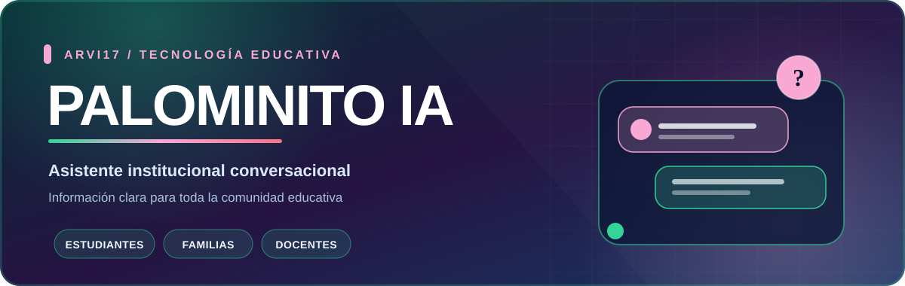

# 🏫 Asistente Institucional Palominito

### Versión 4.0 · Consulta y orientación conversacional

**Un asistente local para encontrar orientación en los documentos institucionales del colegio.**

[**Ver aplicación**](Asistente_Palominito_v4_Conversacional.html) · [**Instrucciones de uso**](LEAME_Asistente_Palominito_v4.txt)

---

## ✨ ¿Qué hace?

| Para quién | Orientación disponible |
| --- | --- |
| 🎓 Estudiantes | Información institucional, evaluación y convivencia. |
| 👨‍👩‍👧 Familias y acudientes | Rutas de consulta y preguntas frecuentes. |
| 👩‍🏫 Docentes | Orientación basada en documentos y temas institucionales. |
| 🧭 Comunidad educativa | Respuestas guiadas y sugerencias de preguntas relacionadas. |

**Características de la versión 4.0**

- Respuestas guiadas por el **PEI Palominito 2025** y el **Manual de Convivencia 2026**.
- Saludos contextuales, consultas conversacionales y rutas de acceso rápido.
- Funcionamiento local en navegador, sin crear una cuenta ni instalar un servidor.
- Opciones para volver al inicio y consultar el estado técnico.

## 🚀 Inicio rápido

1. Descarga el archivo [`Paquete_Asistente_Palominito_v4_Conversacional.zip`](Paquete_Asistente_Palominito_v4_Conversacional.zip).
2. **Extrae** el archivo ZIP en una carpeta de tu computador.
3. Abre `Asistente_Palominito_v4_Conversacional.html` con Chrome o Edge.
4. Escribe una pregunta o selecciona una ruta temática.

También puedes consultar el [manual de uso](LEAME_Asistente_Palominito_v4.txt) y el [informe gerencial y técnico](Informe_Gerencial_Tecnico_Asistente_Palominito_v4.docx).

## 🔐 Alcance y privacidad

La aplicación está diseñada para orientar a partir de documentos institucionales, **no para consultar datos personales de estudiantes, calificaciones, expedientes ni información médica**. Sus respuestas no reemplazan las decisiones oficiales de rectoría, coordinación u otras instancias educativas.

## 🧰 Tecnología

- **HTML, CSS y JavaScript**, con ejecución local en el navegador.
- Compatibilidad ampliada con equipos menos recientes mediante JavaScript ES5.
- Sin dependencia de un servidor o de un servicio de IA remoto para las consultas documentadas.

---

Proyecto de <a href="https://github.com/ARVI17">ARVI17</a> · Orientación educativa con información documentada

